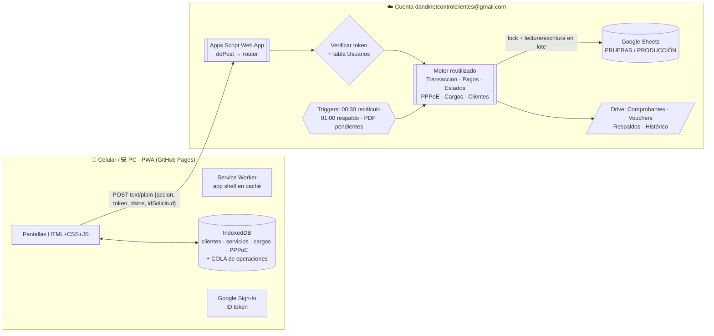

# D@NDINET Control · Opción B (PWA offline + Apps Script + Google Sheets)
## Fase 0: diseño para aprobar antes de programar

| | |
|---|---|
| **Versión** | 1.0 |
| **Fecha** | 16/10/2026 |
| **Base** | Prompt maestro Opción B · `PROYECTO_APP` (Opción A, Fases 0–2) · `CONTROL 2026 v2 - fuentes` |
| **Estado** | ✅ Aprobado por el dueño (16/10/2026), con D1, D2 y D3 como se proponen |

---

## 1. Punto de partida: no empezamos de cero

En `D:\CLAUDE\PROYECTO_APP` ya existe el trabajo de la Opción A (AppSheet), con resultados verificados:

| Qué ya está hecho | Resultado |
|---|---|
| **Migración** de `migracion.json` a las tablas de Google Sheets | ✅ **CUADRA al centavo** contra `esperado.json`: 136 clientes, S/ 98,326.50 pagado, S/ 131,562.00 facturado, S/ 33,235.50 de saldo, S/ 18,975.50 de deuda vencida con 0 diferencias por cliente, 35 PPPoE y 26 asignados |
| **Motor** (port del VBA): recálculo, cargos, pagos, anulación, corte, reactivación, PPPoE, altas, renovación y archivado | ✅ **97/97 pruebas** en un simulador de Google Sheets, con los datos reales |
| Prorrateo del mes de alta (decisión P9 del dueño, 15/10/2026) | ✅ Implementado y probado |

**Propuesta:** la Opción B **reutiliza ese motor tal cual** (las reglas de negocio no cambian) y solo cambia **la puerta de entrada**:

| | Opción A (AppSheet) | **Opción B (esta)** |
|---|---|---|
| Quién llama al motor | Un bot de AppSheet lee una fila de `ColaCobros`/`ColaAcciones` | La PWA llama a `doPost` con JSON |
| Identidad | `USEREMAIL()` de AppSheet | **ID token de Google** verificado en el servidor |
| Offline | Lo resuelve AppSheet | **Lo construimos nosotros**: Service Worker + IndexedDB + cola |
| Roles | ADMIN / COBRADOR / CONSULTA | **Todos ADMIN** (decisión del dueño); la columna ROL se conserva |
| Cobro offline en conflicto | Se RECHAZA | Pasa a **"A REVISAR"** (no se rechaza el dinero) |
| Costo | Workspace + AppSheet (~US$ 21–25/mes) | **S/ 0** |

Así ahorramos varias semanas: las Fases 1 y 2 de la Opción B son, sobre todo, **adaptar y volver a verificar**, no reescribir.

---

## 2. Arquitectura



### 2.1 Principio central (se mantiene de la Opción A): **la app pide, el servidor decide**
- El celular **nunca** asigna números de recibo, ni escribe en la hoja, ni decide si un pago es válido.
- La hoja **no se comparte** con nadie: solo el script (que corre como el dueño) la lee y escribe.
- Cada operación lleva un **`idSolicitud` (UUID v4)** creado en el celular. El servidor lo guarda en `Solicitudes`; si llega repetido, devuelve **el mismo resultado** sin volver a ejecutar nada.

### 2.2 Una operación de escritura, paso a paso
1. `doPost` lee el JSON y **verifica el token** (sección 4). Sin token válido, se responde `TOKEN_INVALIDO` y no se toca nada.
2. **Toma el candado** (`LockService.getScriptLock().waitLock(30000)`). Si no lo consigue en 30 s, responde `OCUPADO` y la app reintenta sola.
3. Busca el `idSolicitud` en `Solicitudes`. **Si ya existe**, devuelve el resultado guardado y termina.
4. Lee las tablas en memoria → **valida todo** → aplica → recalcula **solo al cliente afectado** → escribe solo lo que cambió, en el orden más seguro (detalle → cabecera → … → **contador al final**). Es la "transacción simulada" ya probada en la Opción A.
5. Guarda `Solicitudes` (con el resultado) y `Bitacora` **dentro del mismo candado**.
6. **Suelta el candado** y recién entonces genera el **PDF** (tarda 3–5 s; no debe bloquear a los demás cobradores). Si el PDF falla, el recibo sigue siendo válido: queda `PDF_PENDIENTE` y un trigger lo reintenta.

### 2.3 Correlativo sin saltos ni duplicados
Dentro del candado: `n = max(Config.UltRecibo, mayor N° en Pagos) + 1`. Se escriben detalle y recibo; **al final** `UltRecibo = n`. Un pago rechazado no consume número. Ya está probado (casos 5 y 7 de la Opción A).

---

## 3. Contrato de la API

### 3.1 Formato
**Petición** (siempre `POST`, `Content-Type: text/plain;charset=utf-8` para evitar el *preflight* CORS):
```json
{ "accion": "registrarPago", "token": "<ID token>", "idSolicitud": "3f6c…", "version": "1.0.0", "datos": { … } }
```
**Respuesta:**
```json
{ "ok": true,  "datos": { … }, "servidor": "2026-10-16T09:15:02-05:00" }
{ "ok": false, "error": "El periodo OCT-2026 ya está pagado.", "codigoError": "VALIDACION" }
```

| `codigoError` | Significado | Qué hace la app |
|---|---|---|
| `TOKEN_INVALIDO` | Token ausente, vencido o de otro proyecto | Pide un token nuevo (One Tap) y reintenta |
| `NO_AUTORIZADO` | El correo no está en Usuarios o tiene `ACTIVO = No` | **Borra los datos locales** y cierra la sesión |
| `VALIDACION` | Regla de negocio (DNI inválido, mes pagado, monto mayor…) | Muestra el mensaje; la operación queda en `error` |
| `OCUPADO` | No se consiguió el candado | Reintento con espera exponencial (2, 4, 8, 16 s…) |
| `VERSION` | La app es demasiado antigua | Muestra "Actualizar" |
| `INTERNO` | Error inesperado del servidor | Reintento; si persiste, aviso al ADMIN |
| `PROHIBIDO` | El rol no permite la acción (agregado en la Fase 2) | Muestra el mensaje |

**Fechas en la API:** siempre texto `AAAA-MM-DD` (fechas "solo día") y `AAAA-MM-DDTHH:mm:ss-05:00` para fecha y hora. Así no hay desfases entre el navegador, Apps Script y Sheets. **Montos:** número con 2 decimales.

### 3.2 Acciones

| Acción | `datos` | Devuelve |
|---|---|---|
| `perfil` | — | usuario, rol, zonas, config pública, versión mínima de la app |
| `sincronizarDatos` | `{desde?}` (marca de tiempo de la última sync) | clientes, servicios, cargos **no saldados**, PPPoE, catálogos y `hasta` (nueva marca). Sin `desde` = descarga completa |
| `registrarPago` | `{idCliente, idsCargos[], monto, metodo, operacion, fechaPago, fDispositivo, origen, fotoBase64?, gps?, obs}` | `{nroRecibo, urlPdf, saldoRestante, estado: "Válido" | "A revisar"}` |
| `procesarCola` | `{operaciones: [{accion, idSolicitud, datos}, …]}` (máx. 20 por llamada) | un resultado por operación, en el mismo orden |
| `anularPago` | `{nroRecibo, motivo}` (motivo obligatorio) | recibo anulado + PDF con marca ANULADO |
| `cambiarEstadoServicio` | `{idServ, tipo: CORTE|SUSPENSION|BAJA, fecha, motivo, cobrarMesCorte}` | resumen + mensaje y enlace de WhatsApp |
| `reactivarServicio` | `{idServ, fecha, codigoPPPoE, tarifa?, motivo}` | resumen + deuda pendiente |
| `guardarCliente` | `{cliente}` (sin ID = alta) | `{idCliente}` |
| `nuevoServicio` | `{idCliente, plan, modo, tarifa, codigoPPPoE?, fecha, montoInstalacion?}` | `{idServ, cuotasGeneradas}` |
| `cambiarPlan` | `{idServ, plan, modo, tarifa, desde}` | cuotas modificadas |
| `pppoe` | `{op: asignar|liberar|bloquear|desbloquear|agregar, codigo, idServ?, motivo?, titular?}` | estado del código |
| `listaCorte`, `cobranza`, `dashboard`, `reportePPPoE`, `misCobros` | filtros (periodo, zona, plan, estado, usuario) | datos para la pantalla |
| `resolverRevision` | `{idSolicitud, resolucion: APLICAR|ADELANTO|DEVOLVER, idsCargos?, motivo}` | recibo emitido o caso cerrado |
| `renovarAnio`, `archivarAnio`, `verificarCuadre` | `{anio}` | resultado ("CUADRA" en el archivado) |

Las acciones de solo lectura no necesitan `idSolicitud`; **todas las de escritura sí**.

---

## 4. Seguridad e identidad

### 4.1 Verificación del token (en cada llamada)
1. La PWA obtiene el **ID token** con Google Identity Services (Client ID `223370778430-…`).
2. El servidor lo valida con `https://oauth2.googleapis.com/tokeninfo?id_token=…` y exige:
   - `aud` = Client ID guardado en `Config.ClientId_OAuth`;
   - `iss` = `accounts.google.com` o `https://accounts.google.com`;
   - `email_verified` = true y `exp` en el futuro;
   - el correo está en **Usuarios** con `ACTIVO = Sí`.
3. Para no llamar a Google en cada petición, el resultado se guarda en **CacheService** con la huella (SHA-256) del token hasta que vence (máx. 1 h). La tabla Usuarios también va en caché, **pero solo 60 s**, para que desactivar a alguien tenga efecto casi inmediato.
4. **El rol y las zonas nunca vienen del celular**: el servidor los lee de Usuarios.

### 4.2 Trabajo sin señal y token vencido
- El ID token dura ~1 h. La cola **no guarda el token**; al sincronizar, la app pide uno nuevo (One Tap; si no se puede, un botón "Volver a iniciar sesión").
- La app abre sin internet con la **sesión local** (correo y nombre del último inicio de sesión).
- **Propuesta:** si pasan más de **7 días** sin una sincronización exitosa, la app exige conectarse antes de seguir (configurable: `DiasMaxSinSync`). Esto limita el daño de un celular perdido.

### 4.3 Ley 29733 y repositorio público
- **GitHub Pages gratuito exige que el repositorio sea público.** Por eso el repositorio tendrá **solo código y documentación**: nunca `migracion.json`, Excel, PDF, respaldos ni capturas con datos reales (`.gitignore` estricto, como el que ya usas en `D:\CLAUDE`).
- El Client ID y la URL de la API no son secretos; la seguridad está en el paso 4.1.
- Las claves WiFi y del router bajan al celular **solo con sesión iniciada** y se borran al cerrar sesión o al recibir `NO_AUTORIZADO`.
- PDF de recibos: **propuesta** "cualquiera con el enlace" **solo para el PDF** (para poder mandarlo por WhatsApp). La carpeta y la hoja siguen privadas. Necesita tu aprobación (pregunta D4).

---

## 5. Modelo de datos

Se usan las tablas de la Opción A (ya migradas y cuadradas) con estos ajustes:

| Cambio | Motivo |
|---|---|
| **Se conservan `ResumenCliente` y `ClientesPriv`** separadas de `Clientes` (el prompt B las pone todas en Clientes) | Ya están probadas, y separarlas evita que una edición de teléfono pise los saldos calculados. **La API las entrega juntas**, así que para la app es exactamente el modelo del prompt B. |
| **Nueva `Solicitudes`**: ID_SOLICITUD, USUARIO, ACCION, F_RECIBIDA, F_DISPOSITIVO, ORIGEN, RESULTADO_JSON | Idempotencia (sección 2.1). Reemplaza a `ColaCobros` y `ColaAcciones`. |
| **Nueva `PagosRevisar`**: ID_SOLICITUD, F_COBRO, USUARIO, ID_CLIENTE, CLIENTE, IDS_CARGOS, MONTO, METODO, OPERACION, URL_VOUCHER, GPS, MOTIVO_CONFLICTO, RESOLUCION, N_RECIBO_FINAL, RESUELTO_POR, F_RESOLUCION | Conflictos offline (sección 6.3) |
| `Pagos` + F_DISPOSITIVO, ORIGEN (`online` / `offline` / `MIGRACION`), URL_VOUCHER | Trazabilidad |
| `Comprobantes.ESTADO` admite `PDF_PENDIENTE` | El PDF se genera fuera del candado (sección 2.2) |
| `Usuarios` + INICIALES; se quitan PUEDE_PARCIAL y la restricción de zonas (todos ADMIN, ZONAS = `*`) | Decisión del dueño |
| `ULT_MODIF` (fecha y hora) en Clientes, Servicios, Cargos y PPPoE | Sincronización incremental (`sincronizarDatos` con `desde`) |
| `Config` + `ClientId_OAuth`, `DiasMaxSinSync`, `VersionMinimaApp`, `VoucherObligatorio`, `IdCarpetaVouchers` | Parámetros, nunca fijos en el código |

**Sin cambios:** Clientes, Servicios, Cargos (con CLAVE y VENCE_FIJO), PagosDet, Comprobantes, HistorialEstados, PPPoE, HistPPPoE, Planes, Listas (modos, zonas, métodos), Config y Bitacora.

---

## 6. Modo offline

### 6.1 Qué se guarda en el celular (IndexedDB `dandinet`)
| Almacén | Contenido |
|---|---|
| `clientes`, `servicios`, `cargos`, `pppoe`, `catalogos`, `config` | Copia de lectura (solo cargos **no saldados** + los pagos recientes, para que pese poco) |
| `cola` | Operaciones pendientes: `{idSolicitud, accion, datos, fDispositivo, usuario, estado: pendiente|enviando|ok|error, intentos, resultado}` |
| `recibos` | Recibos emitidos en el celular (provisionales y oficiales) para "Mis cobros de hoy" |
| `meta` | Última sincronización, versión, sesión local |

Las fotos de voucher se guardan comprimidas (JPEG, máx. 1280 px, ~150–250 KB) dentro de la operación.

### 6.2 Cobro sin señal
1. El cobrador marca meses y monto. La app **valida localmente** (mes no pagado en su copia, monto ≤ saldo) solo para dar una mejor experiencia.
2. Se guarda en `cola` con estado `pendiente` y se **descuenta en la copia local** (para que no lo vuelva a cobrar en el mismo celular).
3. Se muestra un **recibo provisional `PEND-<iniciales>-<n>`** con el aviso *"Recibo oficial al sincronizar"*. Se puede enviar por WhatsApp como texto.
4. **Sincronización automática:** al volver la señal (`online`), al abrir la app, cada 5 minutos con la app abierta y con el botón **"Sincronizar ahora"**. No dependemos de Background Sync (no funciona en iPhone).
5. Se envían en orden de creación con `procesarCola` (lotes de 20). El servidor devuelve `R-000xxx` y el enlace del PDF; la app reemplaza el provisional.
6. Indicador fijo arriba: **"En línea · 0 pendientes"** / **"Sin conexión · 3 pendientes de envío"** + hora de la última sincronización.

### 6.3 Conflictos: el dinero recibido nunca se rechaza
Si al sincronizar el cargo ya fue pagado por otro, o el monto supera el saldo actual:
- **No se rechaza**: el cobro se guarda en `PagosRevisar` con el detalle del conflicto, queda en la Bitácora y el ADMIN ve un aviso en **Revisiones**.
- **Propuesta (D2):** mientras está "A revisar" **no consume número R-**. El ADMIN decide:
  - **Aplicar a otro mes** → se emite el recibo R- oficial en ese momento, con la fecha real del cobro;
  - **Adelanto** (saldo a favor) → se aplica a los meses futuros más antiguos, también con R-;
  - **Devolver** → se cierra sin recibo, con motivo.
- Ventaja: el correlativo sigue sin saltos y se mantiene el cuadre **Σ pagos válidos = Σ pagado en cargos**.
- Los rechazos que **no** son de dinero (DNI inválido, PPPoE ocupado, etc.) quedan en `error` en la cola, con el mensaje y un botón para corregir o descartar.

### 6.4 Service Worker y versiones
- **Cache-first** para el app shell (HTML, CSS, JS, íconos, logo y Chart.js), con nombre de caché `dandinet-vX.Y.Z`.
- **Siempre red** para la API (los datos van por IndexedDB, nunca por el caché del SW).
- Cuando hay versión nueva: aviso **"Nueva versión disponible – Actualizar"**. La app **no se actualiza sola si hay operaciones en la cola** sin enviar.

---

## 7. Entornos

| | PRUEBAS | PRODUCCIÓN |
|---|---|---|
| Hoja | `DANDINET_DB_PRUEBAS` | `DANDINET_DB` |
| Proyecto Apps Script | `dandinet-api-pruebas` | `dandinet-api` |
| PWA | `http://localhost:5500` (y `?entorno=pruebas` en GitHub Pages) | `https://antonyhuamani732-netizen.github.io/dandinet-control/` |

Un solo código, dos proyectos de Apps Script: `npm run subir:pruebas` y `npm run subir:prod` hacen `clasp push` con `.clasp.pruebas.json` o `.clasp.produccion.json`. Cada proyecto guarda el ID de su hoja en *Propiedades del script*, nunca en el código.

---

## 8. Repositorio

- Carpeta: **`D:\CLAUDE\PROYECTO_VS_CODE`** como repositorio Git **propio** (el repositorio de `D:\CLAUDE` ya la ignora, así que no se mezclan).
- GitHub: **`antonyhuamani732-netizen/dandinet-control`**, **público** (requisito de Pages gratuito), rama `main`.
- Estructura: la de la sección 8 del prompt (`backend/`, `frontend/`, `migracion/`, `docs/`).
- `backend/` arranca copiando el motor de `PROYECTO_APP/apps-script` (con su historial anotado en el commit), y las pruebas en Node (`pruebas-local/`) se traen también para seguir probando sin Google.

---

## 9. Cuotas de Google (Gmail gratuito) y riesgos

| Límite (cuenta gratuita) | Uso estimado | Comentario |
|---|---|---|
| 6 min por ejecución | Pago: 1–3 s · recálculo nocturno: < 30 s | Holgado |
| 90 min/día de triggers | ~2–3 min/día | Holgado |
| 20,000 UrlFetch/día (tokeninfo) | < 1,000 con la caché | Holgado |
| ~30 ejecuciones simultáneas | 3–5 cobradores | Holgado; el candado ordena las escrituras |
| Escritura con candado | ~1–2 s por pago (lee las tablas en memoria) | **A vigilar:** con 10 cobros simultáneos, el último espera ~15 s. Se mide en la prueba 7 de la Fase 2; si hace falta, se lee solo lo del cliente afectado |

---

## 10. Plan de fases (ajustado a lo ya hecho)

| Fase | Contenido | Reutiliza | Estimado |
|---|---|---|---|
| 0 | Este diseño + crear el repositorio en GitHub | — | esta semana |
| 1 | Hojas PRUEBAS/PRODUCCIÓN en `dandinetcontrolclientes`, migración y **cuadre** en Google | Migración de la Opción A (ya cuadra en local) | 2–4 días |
| 2 | API `doPost`, `Solicitudes`, `PagosRevisar`, `Pruebas.gs` en verde | Motor + 97 pruebas | 1 semana |
| 3 | Inicio de sesión con Google, verificación del token, despliegue | — | 2–3 días |
| 4 | PWA: inicio, búsqueda, ficha y **cobro en línea** | — | 1–2 semanas |
| 5 | **Offline**: SW, IndexedDB, cola, sincronización y conflictos | — | 1–2 semanas |
| 6 | PDF (Docs), WhatsApp y voucher | Monto en letras de VBA | 1 semana |
| 7 | Corte, reactivación, PPPoE y administración | Motor | 1 semana |
| 8 | Dashboard y reportes | — | 1 semana |
| 9 | Aceptación (20 casos), manuales, capacitación y paralelo con el Excel | — | 1–2 semanas |

---

## 11. Decisiones que necesito

**Para aprobar este diseño:**
- **D1.** ¿Reutilizamos el motor de la Opción A (con `ResumenCliente` y `ClientesPriv` separadas en la hoja, unidas en la API)? *Propuesta: sí.*
- **D2.** Cobro offline en conflicto: ¿**sin número R-** hasta que el ADMIN lo resuelva (aplicar a otro mes, adelanto o devolver)? *Propuesta: sí.*
- **D3.** ¿Repositorio **público** en GitHub (solo código, sin datos)? Es obligatorio para Pages gratuito. *Propuesta: sí.*

**Pueden esperar hasta la fase indicada:**
- **D4** (Fase 6). ¿El PDF se comparte como "cualquiera con el enlace" para WhatsApp?
- **D5** (Fase 3). ¿7 días máximo sin sincronizar antes de exigir conexión?
- **D6** (Fase 6). ¿Foto del voucher obligatoria para Yape, Plin y transferencias?
- **D7** (Fase 1, migración real). Datos al día: los pagos posteriores al 04/08/2026 siguen sin registrar. El ensayo usa `migracion.json`; la migración real necesitará el Excel actualizado.
- **D8** (antes de producción). RUC correcto, usuarios (nombre, Gmail e iniciales) y los pendientes heredados: 5 instalaciones por S/ 355, 3 cortados con PPPoE, CLI-0136, 5 teléfonos inválidos y el pago MIG-00265 con fecha 14/12/2026.

---

## 12. Aprobación

- [x] Arquitectura y flujo de una operación (sección 2)
- [x] Contrato de la API (sección 3)
- [x] Seguridad (sección 4)
- [x] Modelo de datos con los ajustes de la sección 5
- [x] Offline y conflictos (sección 6)
- [x] D1, D2 y D3

Aprobado por: el dueño, en la sesión de trabajo · Fecha: 16/10/2026
